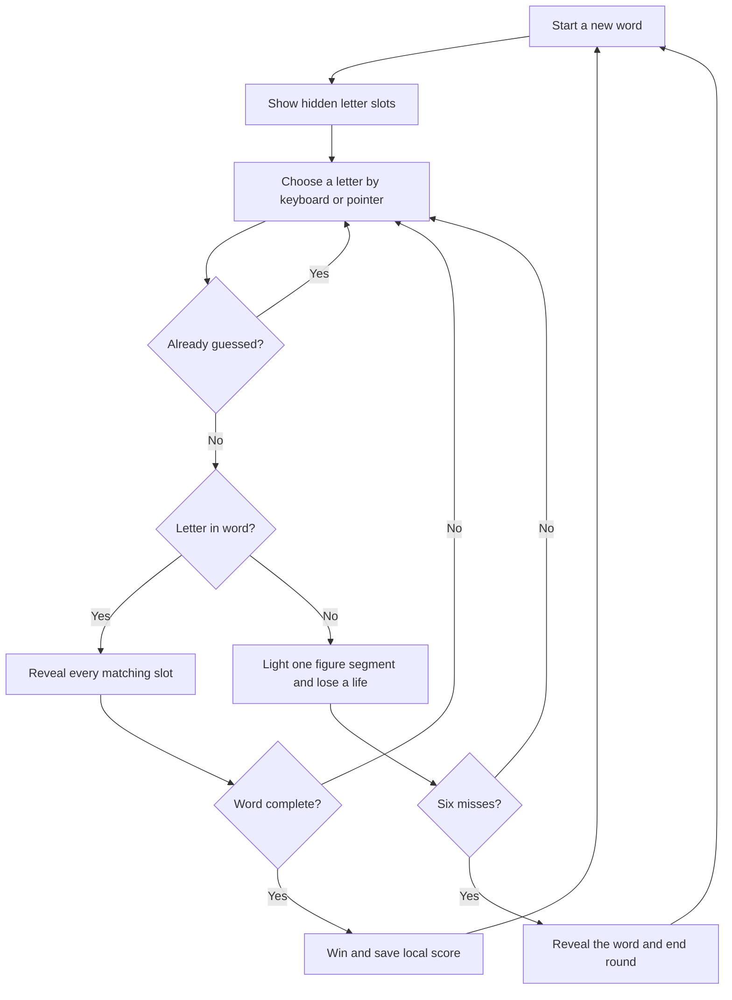

# Letter Pit

A neon-lit hangman game about good guesses and second chances. Built with Vue 3, TypeScript, and Vite; runs entirely in your browser.

**Play:** [oscarmmi.github.io/hangman](https://oscarmmi.github.io/hangman/)

## How to play

- Guess the hidden everyday word one letter at a time.
- Choose a letter on the on-screen keyboard or press **A–Z** on your keyboard.
- Correct guesses reveal every matching letter. Each incorrect guess uses one of your six lives.
- Solve the word before the neon figure is complete to win.
- Choose **New word** or press **R** to start another round. Repeat guesses are ignored.
- Your total solved words is saved in this browser with local storage.

## Run locally

```sh
npm install
npm run dev
```

Run the game-logic tests and production build:

```sh
npm test
npm run build
```

## Game loop



## Built with

- Vue 3 and TypeScript
- Vite and Vitest
- Original inline SVG hangman illustration

## GitHub Pages

Every push to `main` runs the tests, builds `dist/`, and deploys it to [https://oscarmmi.github.io/hangman/](https://oscarmmi.github.io/hangman/).
